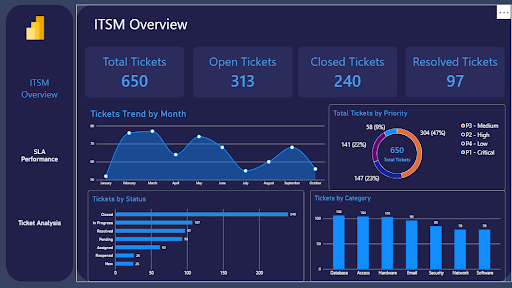
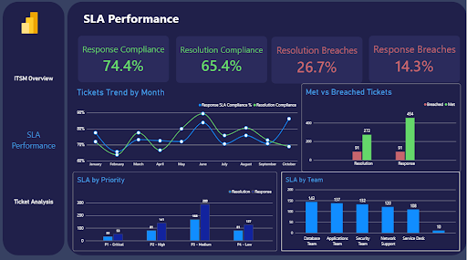
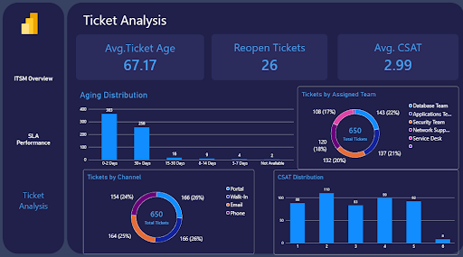

# 🎫 ITSM & SLA Analysis | Data Analytics Project

## 📌 Project Overview

This project focuses on analyzing IT Service Management (ITSM) ticket data to evaluate service desk performance, monitor SLA compliance, identify ticket resolution trends, and generate actionable business insights.

The goal is to understand ticket management efficiency and identify areas for improving IT service delivery.

## 🛠️ Tools & Technologies

- Python
- Pandas
- NumPy
- Microsoft Power BI
- Power Query
- DAX
- Data Cleaning
- Data Visualization

## 📂 Dataset Description

The project uses an ITSM ticket dataset containing information about:

- Ticket IDs
- Ticket Categories
- Priorities
- Ticket Status
- Assigned Teams
- Creation Dates
- First Response Dates
- Resolution Dates
- Closure Dates
- Customer Satisfaction

## ⚙️ Data Cleaning & Preparation

The data preparation process included:

1. Removing duplicate records.
2. Handling missing values.
3. Standardizing column names and text values.
4. Converting date columns into appropriate data types.
5. Validating date sequences and logical consistency.
6. Preparing the dataset for analysis and visualization.

## 📊 Key Performance Indicators (KPIs)

- Total Tickets
- Resolved Tickets
- Open Tickets
- SLA Compliance Rate
- Average Resolution Time
- Average First Response Time
- Customer Satisfaction

## 📸 Dashboard Screenshots

### 1. ITSM Overview

  

### 2. SLA Performance

  

### 3. Ticket Analysis

  

## 🎯 Project Objectives

- Evaluate IT service desk performance.
- Monitor SLA performance.
- Analyze ticket distribution and resolution.
- Identify operational bottlenecks.
- Support data-driven decision-making.

## 👨‍💻 Author

**Mahmoud Nader**

Computer Science Graduate | Junior Data Analyst

- GitHub: [Mahmoud Nader](https://github.com/MahmoudNader1)
- LinkedIn: [Mahmoud Nader](https://www.linkedin.com/in/mahmoud-nader-810291405/)
